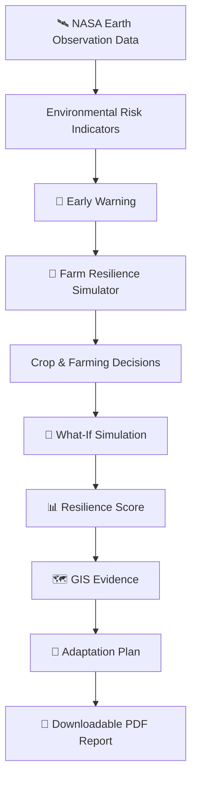

::: {align="center"}
# 🌾 VaporPath Farm Resilience Simulator

### *Follow the moisture. Protect the harvest.*

:::

------------------------------------------------------------------------

## 🌍 Overview

**VaporPath** is a **farm resilience simulator** designed for the NASA
Space Apps Challenge track **"Adapting Farms with NASA Data."**

Instead of presenting NASA Earth observations as a complex data
dashboard alone, VaporPath turns the science into an interactive farmer
journey:

**Farmer Story → Select Farm → Early Warning → NASA Farm Scan → Crop
Decision → What-If Simulation → Resilience Score → GIS Evidence →
Adaptation Plan → PDF Report**

The goal is to help farmers and agricultural planners understand
environmental risk, explore adaptation choices, and make more resilient
decisions before potential climate-related losses occur.

> **Challenge Track:** Adapting Farms with NASA Data\
> **Team Name:** The_Alchemist

------------------------------------------------------------------------

## 🚨 The Problem

Farmers often need to make important crop and water-management decisions
while environmental conditions are changing.

Moisture availability, rainfall patterns, soil conditions, temperature,
and vegetation stress can influence crop resilience. However, satellite
observations and environmental datasets are difficult for many users to
interpret directly.

VaporPath addresses this gap by turning complex Earth-observation
information into a simple, story-driven decision experience.

-   🌦️ Environmental risk can develop before visible crop damage
-   🛰️ NASA Earth observations provide valuable information about soil
    moisture, rainfall, and vegetation conditions
-   🌾 Farmers need understandable information that connects
    environmental risk to practical crop decisions
-   📊 Decision-makers also need spatial evidence and reports they can
    share

------------------------------------------------------------------------

## 💡 Our Solution

VaporPath combines four major capabilities into one farmer-centered
experience:

### 🎮 1. Farm Resilience Simulator

The **hero feature** of VaporPath.

Users select a representative farm region, explore environmental risk,
choose farming strategies, test different crop decisions, and see how
those decisions affect their **Resilience Score**.

The simulator transforms climate adaptation from a technical report into
an interactive **"what-if" experience**.

### 🚨 2. Early Warning Alerts

VaporPath presents early warning indicators when environmental
conditions suggest increased potential water or crop stress.

The alert experience helps users move from:

**"Something may be changing." → "What should I do?"**

### 🗺️ 3. GIS Dashboard

The GIS layer provides the scientific evidence behind the simulator.

It can be used to visualize:

-   Farm/region location
-   Environmental risk
-   Soil-moisture conditions
-   Rainfall information
-   Vegetation or thermal stress
-   Spatial evidence supporting adaptation decisions

### 📄 4. Downloadable PDF Report

After completing the simulation, users can generate a **Farm Resilience
Report** containing their selected farm, decisions, resilience result,
and recommended adaptation plan.

This turns the game experience into a practical, shareable output.

------------------------------------------------------------------------

## 🛰️ NASA Data Sources

VaporPath is built around NASA Earth-observation data and NASA open-data
services.

### 🔗 Links Used in the Project

| Link | Project Role | Simple Explanation |
|------|--------------|--------------------|
| [power.larc.nasa.gov](https://power.larc.nasa.gov/) | Weather Data API | Provides daily temperature, humidity, sunlight, and rainfall data for selected areas. |
| [worldview.earthdata.nasa.gov](https://worldview.earthdata.nasa.gov/) | Satellite Images | Provides satellite images and map layers to display on the interactive map. |
| [earthdata.nasa.gov/user-resources/remote-sensors](https://earthdata.nasa.gov/user-resources/remote-sensors) | Satellite Sensor Guide | Provides information about satellite sensors used to monitor soil moisture, rainfall, plant health, and environmental conditions. |

-   **NASA POWER:** Collects weather and climate data.
-   **NASA Worldview:** Displays satellite images on the map.
-   **NASA Remote Sensors:** Provides scientific information about
    monitoring soil, rainfall, and vegetation using satellites.

### 🔭 Extended NASA Data (Planned Integration)

The following missions are the intended next-step data sources for
deeper soil-moisture, rainfall, and plant-stress analysis.

| Dataset / Service | Agency | Intended Role in VaporPath |
|-------------------|--------|----------------------------|
| **SMAP** | NASA JPL | Soil moisture and root-zone moisture information |
| **GPM IMERG** | NASA / JAXA | Precipitation and rainfall information |
| **ECOSTRESS** | NASA JPL | Evaporative and thermal stress information |
| **Landsat** | NASA / USGS | Vegetation, land-surface and supporting spatial evidence |

> **Prototype data note:** Where a live NASA observation is not
> available in the prototype environment, displayed values are treated
> as **illustrative/demo values** rather than being presented as
> verified real-time satellite observations. The project is designed so
> verified NASA inputs can drive the same risk and simulation workflow.

------------------------------------------------------------------------

## ⚙️ How VaporPath Works

### 🔄 Core User Journey

1.  **Farmer Story** --- Introduce the environmental challenge through a
    simple narrative.
2.  **Select Your Farm** --- Choose a representative farming region.
3.  **NASA Farm Scan** --- Present soil moisture, rainfall, and
    crop/environmental indicators.
4.  **Early Warning** --- Highlight potential environmental risk.
5.  **Understand the Risk** --- Explain how moisture and rainfall
    changes may affect the farm.
6.  **Choose Your Crop / Strategy** --- Let the user make a farming
    decision.
7.  **What-If Simulation** --- Compare alternative decisions.
8.  **Resilience Score** --- Show how the selected strategy performs.
9.  **GIS Evidence** --- Connect the decision to spatial environmental
    information.
10. **Adaptation Plan** --- Summarize the recommended response.
11. **PDF Report** --- Provide a downloadable record of the user's farm
    resilience plan.

------------------------------------------------------------------------

## 🖥️ Main Features

### 🌾 Farm Resilience Simulator

An interactive game-like experience where users make farming decisions
and explore their consequences.

### 🚨 Early Warning Alerts

Clear, user-friendly alerts that communicate potential moisture,
rainfall, or crop-stress risks.

### 🗺️ GIS Dashboard

A spatial evidence layer connecting farm decisions with environmental
conditions.

### 🔄 What-If Decision Simulation

Users can change farming choices and immediately compare outcomes.

### 📊 Resilience Score

A simplified score that communicates the relative resilience of the
selected farming strategy.

### 🌱 Crop Rotation / Adaptation Planning

Users can explore multi-season crop choices and adaptation strategies.

### 📄 Downloadable Farm Resilience Report

A PDF output summarizing the selected farm, decisions, resilience
result, and adaptation plan.

### 🎭 Story-Driven Interface

A farmer-centered interface makes complex environmental science easier
to understand and demonstrate.

------------------------------------------------------------------------

## 🎯 Target Users

  -----------------------------------------------------------------------
  User Group                          Use Case
  ----------------------------------- -----------------------------------
  **Smallholder Farmers**             Understand environmental risk and
                                      explore adaptation choices

  **Commercial Farms**                Compare crop and water-management
                                      strategies

  **Agricultural Cooperatives**       Review regional environmental
                                      evidence and adaptation plans

  **Agricultural Planners**           Use GIS evidence and reports for
                                      planning

  **Students & Public Users**         Learn how NASA Earth observations
                                      can support agriculture
  -----------------------------------------------------------------------

------------------------------------------------------------------------

## 🌱 Impact & Vision

VaporPath aims to make Earth-observation science more understandable and
actionable.

  -----------------------------------------------------------------------
  Goal                                How VaporPath Helps
  ----------------------------------- -----------------------------------
  💧 **Water Resilience**             Helps users understand changing
                                      moisture conditions

  🌾 **Food Security**                Encourages proactive crop and
                                      adaptation decisions

  📡 **Open NASA Science**            Translates Earth-observation
                                      information into an accessible
                                      experience

  🗺️ **Spatial Awareness**            Uses GIS to connect environmental
                                      conditions with locations

  🌍 **Climate Adaptation**           Lets users test possible responses
                                      before risk becomes crop loss

  📄 **Actionable Output**            Converts simulation results into a
                                      downloadable adaptation report
  -----------------------------------------------------------------------

------------------------------------------------------------------------

## 🧪 Prototype Scope & Scientific Transparency

VaporPath is a prototype created for the NASA Space Apps Challenge.

The simulator demonstrates the **decision-support workflow** rather than
claiming to replace professional agricultural forecasting.

Where live NASA data are connected, their source and role are
identified. Where data access or processing is unavailable during the
prototype demonstration, values are explicitly treated as illustrative.

The project does **not** claim that Amazon moisture transport directly
caused conditions at a specific farm. The moisture-corridor experience
is presented as an illustrative explanation of a potential regional
connection that requires appropriate scientific evidence.

------------------------------------------------------------------------

## 🎨 Design & Asset Sources

The project uses external references for interface design, color
inspiration, character/illustration references, and visual concepts.

### Design / Color References

-   https://www.orbix.studio/
-   https://www.samrusztyn.ca/production_work/color-key

### Visual / Illustration References

-   https://i.pinimg.com/1200x/93/8e/a9/938ea92198a64065daf0b0e652d048c8.jpg
-   https://creator.nightcafe.studio/creation/Di2RzSlRFKBfcWVgj10H?utm_source=Pinterest&utm_medium=organic
-   https://www.pinterest.com/pin/822892163212278900/

### Simulation Character / Design References

-   https://www.pinterest.com/pin/822892163212254320/
-   https://www.pinterest.com/pin/822892163212254292/
-   https://www.rawpixel.com/image/12128778/image-white-background-plant?utm_source=Pinterest&utm_medium=organic

> These links are included as **design and visual references**. They are
> not presented as NASA data sources.

------------------------------------------------------------------------

## 👨‍🚀 Team --- The_Alchemist

> *Turning Earth-observation science into practical farm resilience
> decisions.*

**Project:** VaporPath\
**Challenge:** Adapting Farms with NASA Data\
**Team:** The_Alchemist

------------------------------------------------------------------------

## 📄 License & Data Attribution

This project is developed for the **NASA Space Apps Challenge**.

NASA data and services are used according to their applicable open-data
and usage policies. External visual/design references are listed above
for attribution and transparency.

For NASA Earth data and services:

-   https://earthdata.nasa.gov/
-   https://www.nasa.gov/open/data.html

------------------------------------------------------------------------

::: {align="center"}
**🌍 VaporPath --- Follow the moisture. Protect the harvest.**

:::
